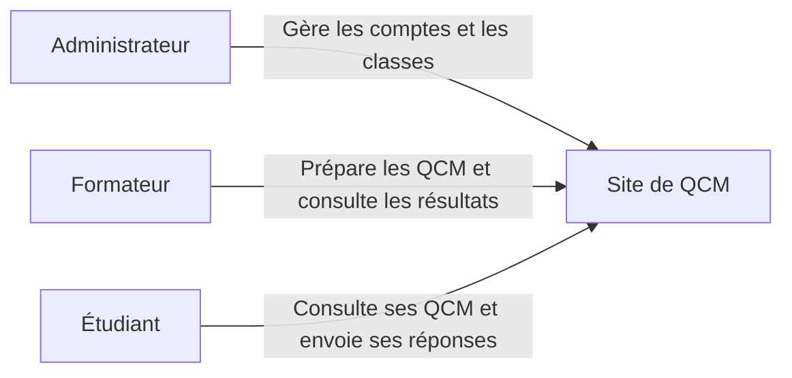
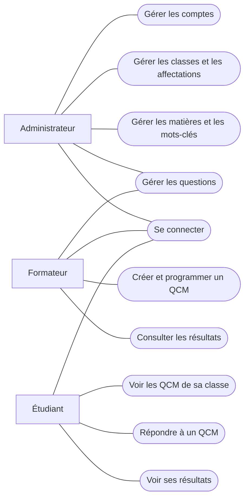

# Rendu 3 - Conception du projet QCM

Yassin Sadki, Elif Karasu et Evguenii Seredkin

## Le projet

On doit faire un site de QCM pour les formateurs et les étudiants. Le formateur prépare un QCM pour une classe et choisit quand il sera disponible. Les étudiants répondent depuis leur compte et peuvent ensuite voir leur résultat. L'admin s'occupe des comptes, des classes, des matières et des mots-clés.

## Charte graphique et maquettes

On part sur un fond blanc, un menu bleu foncé et des boutons bleus. On garde la même police (Arial) et le même menu sur les pages, avec des liens différents selon le rôle. Sur la liste des QCM, on affiche le statut à côté du titre pour savoir directement si on peut le faire.

Voilà comment on a prévu les écrans.

```text
CONNEXION
Email         [                     ]
Mot de passe  [                     ]
              [ Se connecter ]

ADMIN
Utilisateurs | Classes | Matières | Mots-clés | Questions
Utilisateurs   [ Ajouter un compte ]
Nom / Prénom     Email     Rôle     [ Modifier ] [ Supprimer ]

FORMATEUR
Mes QCM | Questions | Résultats
Nouveau QCM
Titre [             ]   Classe [ Choisir ]   Matière [ Choisir ]
Début [             ]   Fin    [         ]
Nombre de questions [   ]   Mots-clés [ PHP ] [ SQL ]
[ Créer le QCM ]

ÉTUDIANT
Mes QCM | Mes résultats
QCM PHP      À venir
QCM SQL      Disponible     [ Commencer ]
QCM Réseau   Terminé        [ Voir mon résultat ]

QCM SQL - Question 1
À quoi sert SELECT ?
( ) À lire des données
( ) À supprimer une table
[ Question suivante ]     [ Valider le QCM ]
```

## Navigation

On arrive sur la page de connexion. Une fois connecté, chacun arrive sur son espace. L'admin passe par son menu pour gérer les comptes et les classes. Le formateur peut aller dans ses QCM, ses questions ou ses résultats. L'étudiant arrive sur la liste des QCM de sa classe. Si le QCM est à venir, il voit juste le titre. S'il est ouvert et qu'il n'a pas encore validé, il peut répondre. Une fois validé, il peut consulter son résultat et ses réponses sont bloquées.

## Diagramme de contexte



## Cas d'utilisation



## MCD


Un enseignement relie une classe, une matière et le formateur qui l'assure. On rattache le QCM à cet enseignement pour savoir à qui il est destiné. Le formateur choisit des mots-clés et un nombre de questions. Le site tire les questions au hasard et garde celles qui ont été tirées pour chaque QCM.

Quand un étudiant passe un QCM, on garde sa tentative, les réponses qu'il a choisies et son score. On a prévu une tentative par étudiant et par QCM. Une question déjà utilisée dans un QCM peut être dupliquée si on veut la modifier.

## MLD

CLASSE = (idClasse, nomClasse, anneeScolaire);

MATIERE = (idMatiere, nomMatiere);

UTILISATEUR = (idUtilisateur, nom, prenom,
email, mdpHash, role, #idClasse);

ENSEIGNEMENT = (idEnseignement, #idUtilisateur,
#idClasse, #idMatiere);

QCM = (idQcm, titre, dateDebut, dateFin,
nombreQuestions, #idEnseignement);

QUESTION = (idQuestion, enonce, typeQuestion,
commentaireCorrection);

PROPOSITION = (idProposition, texte, estCorrect,
ordreCorrect, #idQuestion);

MOT_CLE = (idMotCle, libelle);

TENTATIVE = (idTentative, dateValidation,
score, #idUtilisateur, #idQcm);

HABILITER = (#idUtilisateur, #idMatiere);

UTILISER_CRITERE = (#idQcm, #idMotCle);

CLASSER = (#idQuestion, #idMotCle);

CONTENIR = (#idQcm, #idQuestion);

SELECTIONNER = (#idTentative, #idProposition,
ordreSaisi);

## Dossiers du projet

```text
app/
  Controllers/
  Models/
  Views/
config/
docs/
public/
  index.php
  assets/
```

On utilise le MVC. Le contrôleur reçoit la demande, le modèle récupère ou enregistre les données dans MariaDB et la vue affiche la page. Apache pointe vers `public/` pour que les fichiers de configuration restent en dehors du dossier accessible sur le site.

On va hacher les mots de passe avec `password_hash` et utiliser des requêtes préparées avec PDO. Le serveur vérifie le rôle à chaque action. Par exemple, un étudiant peut seulement accéder aux QCM de sa classe et consulter ses propres résultats. Les réglages de connexion à la base restent en local et les fichiers qui contiennent des secrets sont ignorés par Git.


## MAQUETTE


