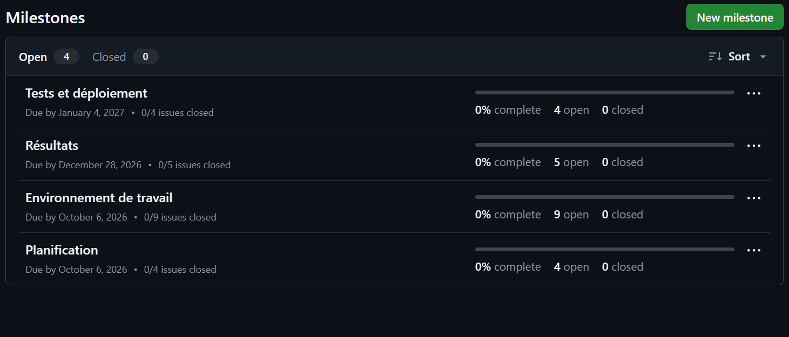
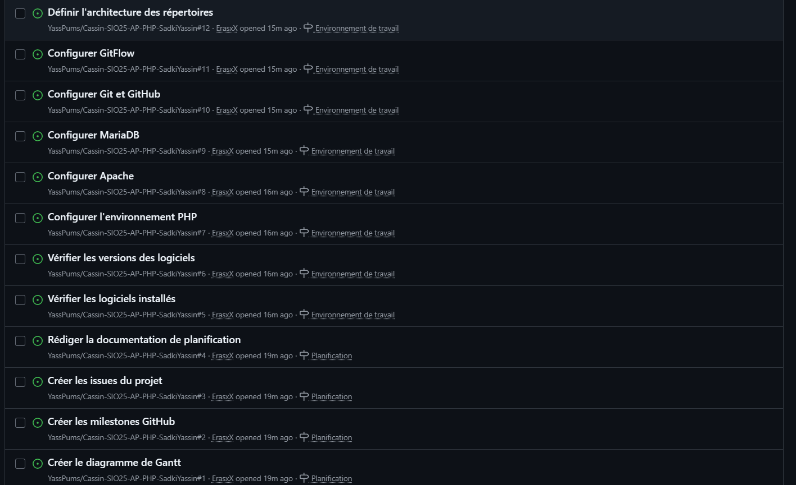

# Planification du projet

## 1. Présentation du projet

Le projet consiste à développer une plateforme web permettant de créer, gérer et réaliser des QCM en ligne.

L'application sera développée en PHP selon le modèle MVC. Elle utilisera HTML, CSS et JavaScript pour l'interface et MariaDB pour la gestion des données.

La plateforme permettra aux administrateurs de gérer les utilisateurs, les classes, les matières et les mots-clés. Les formateurs pourront créer des questions et des QCM. Les étudiants pourront réaliser les QCM correspondant à leur classe et consulter leurs résultats.

---

## 2. Organisation du projet

Le projet est organisé autour de quatre grandes étapes correspondant aux quatre Milestones du projet GitHub :

1. **Planification du projet**
2. **Organisation de l'environnement de travail**
3. **Conception de l'application**
4. **Réalisation de l'application**

Chaque étape regroupe plusieurs tâches qui seront suivies avec GitHub.

### Rendu 1 – Planification du projet

Cette étape permet de définir les objectifs du projet, les différentes tâches à réaliser, le planning prévisionnel et l'organisation du suivi avec GitHub.

### Rendu 2 – Organisation de l'environnement de travail

Cette étape consiste à mettre en place l'environnement nécessaire au développement : Linux/WSL, Apache, PHP, MariaDB, Git, GitHub, Visual Studio Code et les différents outils utilisés pour le projet.

### Rendu 3 – Conception de l'application

Cette étape permet de préparer la structure de l'application avant son développement.

Elle comprend notamment :

- la définition de l'architecture MVC ;
- la conception de la base de données ;
- la réalisation du MCD et du MLD ;
- la réalisation des diagrammes UML ;
- la réalisation des maquettes des interfaces.

### Rendu 4 – Réalisation de l'application

Cette étape correspond au développement de la plateforme.

Elle comprend notamment :

- la création de la base de données ;
- l'authentification ;
- la gestion des utilisateurs ;
- la gestion des classes et des matières ;
- la gestion des questions et des mots-clés ;
- la création et la gestion des QCM ;
- la réalisation des QCM par les étudiants ;
- l'affichage des résultats ;
- les tests et les corrections ;
- le déploiement de l'application.

---

## 3. Planning prévisionnel

Le projet est organisé en quatre grandes étapes correspondant aux quatre rendus demandés.

| **Étape**                                      | **Début**  | **Fin**    |
| ---------------------------------------------- | ---------- | ---------- |
| Rendu 1 – Planifier le projet                  | 28/09/2026 | 12/10/2026 |
| Rendu 2 – Organiser l'environnement de travail | 28/09/2026 | 12/10/2026 |
| Rendu 3 – Concevoir l'application              | 12/10/2026 | 16/11/2026 |
| Rendu 4 – Réaliser l'application               | 16/11/2026 | 04/01/2027 |

Les différentes tâches de développement seront réalisées progressivement pendant la phase de réalisation.

---

## 4. Tâches d'autoformation

Les tâches d'autoformation prévues pour le projet sont :

- Découverte et utilisation de Git et GitHub ;
- apprentissage du workflow GitFlow ;
- approfondissement de PHP orienté objet ;
- apprentissage du modèle MVC ;
- utilisation de MariaDB et du langage SQL ;
- utilisation de HTML et CSS ;
- utilisation de JavaScript ;
- réalisation de diagrammes UML ;
- conception d'une base de données ;
- sensibilisation à la sécurité des applications web ;
- utilisation de l'environnement Linux/WSL.

Ces connaissances permettront de réaliser les différentes étapes du projet et de travailler dans un environnement professionnel.

---

## 5. Diagramme de Gantt

Le diagramme de Gantt présente les différentes tâches du projet et leur période de réalisation.

| **Tâches**                             | **28/09** | **05/10** | **12/10** | **19/10** | **26/10** | **02/11** | **09/11** | **16/11** | **23/11** | **30/11** | **07/12** | **14/12** | **21/12** | **28/12** | **04/01** |
| -------------------------------------- | --------- | --------- | --------- | --------- | --------- | --------- | --------- | --------- | --------- | --------- | --------- | --------- | --------- | --------- | --------- |
| **Rendu 1 – Planification**            | ■         | ■         |           |           |           |           |           |           |           |           |           |           |           |           |           |
| Planification du projet                | ■         | ■         |           |           |           |           |           |           |           |           |           |           |           |           |           |
| Gantt et suivi GitHub                  | ■         | ■         |           |           |           |           |           |           |           |           |           |           |           |           |           |
| **Rendu 2 – Environnement de travail** | ■         | ■         |           |           |           |           |           |           |           |           |           |           |           |           |           |
| Installation des outils                | ■         | ■         |           |           |           |           |           |           |           |           |           |           |           |           |           |
| Configuration de l'environnement       | ■         | ■         |           |           |           |           |           |           |           |           |           |           |           |           |           |
| **Rendu 3 – Conception**               |           |           | ■         | ■         | ■         | ■         | ■         |           |           |           |           |           |           |           |           |
| Architecture de l'application          |           |           | ■         | ■         |           |           |           |           |           |           |           |           |           |           |           |
| Conception de la base de données       |           |           |           | ■         | ■         | ■         |           |           |           |           |           |           |           |           |           |
| MCD / MLD                              |           |           |           |           | ■         | ■         | ■         |           |           |           |           |           |           |           |           |
| Diagrammes UML                         |           |           |           |           | ■         | ■         | ■         |           |           |           |           |           |           |           |           |
| Maquettes                              |           |           |           |           |           | ■         | ■         |           |           |           |           |           |           |           |           |
| **Rendu 4 – Réalisation**              |           |           |           |           |           |           |           | ■         | ■         | ■         | ■         | ■         | ■         | ■         | ■         |
| Création de la base de données         |           |           |           |           |           |           |           | ■         |           |           |           |           |           |           |           |
| Authentification                       |           |           |           |           |           |           |           | ■         | ■         |           |           |           |           |           |           |
| Gestion des utilisateurs               |           |           |           |           |           |           |           |           | ■         | ■         |           |           |           |           |           |
| Gestion des classes et matières        |           |           |           |           |           |           |           |           |           | ■         | ■         |           |           |           |           |
| Gestion des questions et mots-clés     |           |           |           |           |           |           |           |           |           |           | ■         | ■         |           |           |           |
| Gestion des QCM                        |           |           |           |           |           |           |           |           |           |           |           | ■         | ■         |           |           |
| Gestion des résultats                  |           |           |           |           |           |           |           |           |           |           |           |           | ■         | ■         |           |
| Tests et corrections                   |           |           |           |           |           |           |           |           |           |           |           |           |           | ■         | ■         |
| Déploiement                            |           |           |           |           |           |           |           |           |           |           |           |           |           |           | ■         |

---

## 6. Organisation Git

Le projet utilise Git pour assurer le suivi des versions.

L'organisation GitFlow est utilisée avec les branches suivantes :

- `main` : version stable du projet ;
- `develop` : branche principale de développement ;
- `feature/*` : branches dédiées au développement des fonctionnalités.

Exemples de branches :

```
feature/authentification
feature/gestion-utilisateurs
feature/gestion-questions
feature/gestion-qcm
```

## 7. Suivi du projet avec GitHub

GitHub sera utilisé pour suivre l'avancement du projet.

Le projet est organisé autour de quatre **Milestones** :

- **Planification** : 12/10/2026
- **Environnement de travail** : 12/10/2026
- **Conception** : 16/11/2026
- **Tests et déploiement** : 04/01/2027

Les tâches à réaliser sont représentées par des **Issues**.

Chaque Issue est associée à la Milestone correspondant à la phase du projet concernée.

## 8. Rendus

| **Rendu**                                            | **Date**   |
| ---------------------------------------------------- | ---------- |
| Rendu 1 – Planification du projet                    | 12/10/2026 |
| Rendu 2 – Organisation de l'environnement de travail | 12/10/2026 |
| Rendu 3 – Conception de l'application                | 16/11/2026 |
| Rendu 4 – Réalisation de l'application               | 04/01/2027 |

## 9. Suivi GitHub

Le suivi du projet est réalisé avec GitHub.

Les différentes tâches sont créées sous forme d'issues et sont associées aux quatre milestones du projet.

### Milestones GitHub



### Issues GitHub

